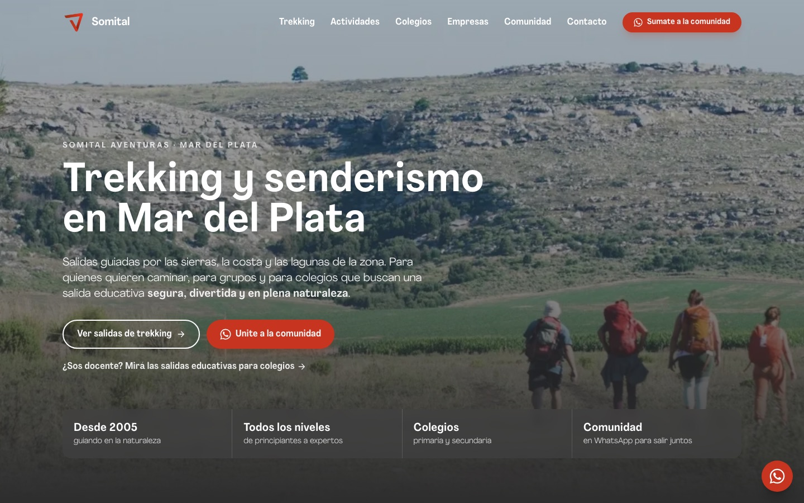

# Somital Aventuras

Production website for an adventure tourism company in Mar del Plata, Argentina: guided trekking, school field trips and corporate team building.

**Live:** https://www.somital.com.ar

[](https://www.somital.com.ar)

## Stack

Next.js 15 (App Router) · React 19 · Tailwind CSS · Google Maps JavaScript API · Google Tag Manager · Vercel

## Highlights

- **SEO built for local search.** JSON-LD for `LocalBusiness`, `TouristTrip`, `FAQPage`, `ItemList` and `BreadcrumbList`; canonical URLs and Open Graph per page; generated sitemap and robots.txt with per-route priorities.
- **Safe migrations.** 308 redirects from every legacy URL to its new route, so indexed pages keep their ranking after the redesign.
- **WhatsApp as the conversion channel.** Every CTA and the contact form open a prefilled WhatsApp chat, and each click is tracked as a GTM `dataLayer` event for Google Ads conversions.
- **Content as data.** Activities, FAQs, locations and contact info live in JSON under `src/data/`; detail pages are statically generated from it with dynamic `[slug]` routes.
- **Interactive map** of activity locations with custom markers.

## Structure

```
src/
  app/        routes: home, /actividades, /actividades/colegios, /trekking-mar-del-plata, /empresas, /comunidad
  sections/   page sections (hero, activities, FAQ, location…)
  components/ shared UI (navbar, cards, map, WhatsApp links, JSON-LD)
  lib/        SEO schema builders and WhatsApp link helpers
  data/       site content as JSON
```

## Run locally

```bash
npm install
echo "NEXT_PUBLIC_GOOGLE_MAPS_API_KEY=your_key" > .env.local
npm run dev
```

`NEXT_PUBLIC_WTP_NUMBER` optionally overrides the WhatsApp number in `src/data/site.json`.
